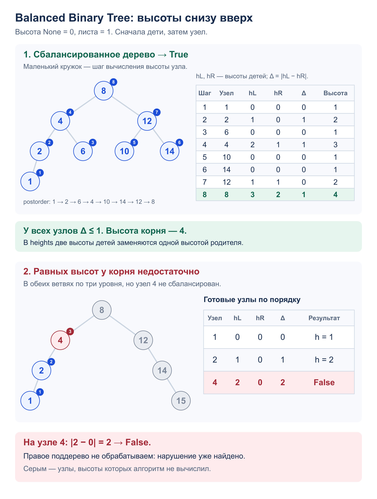

# Задача 3. Balanced Binary Tree

Проверить, отличаются ли высоты поддеревьев не более чем на 1 у каждого узла.
Ответ – `True` или `False`.

[Решение](solution.py) · [Тесты](test_solution.py) · [Узел дерева](../tree.py)

## Алгоритм

`is_balanced(root)` вычисляет высоты в порядке postorder: левое поддерево,
правое, затем узел. Высота пустого дерева – 0, листа – 1.

Первый стек хранит узлы с флагом `ready`: готовый узел обрабатывается после детей.
Второй, `heights`, хранит высоты завершённых поддеревьев. Для `None` кладём 0.
У готового узла снимаем сначала высоту правого ребёнка, затем левого.
Если разность больше 1, возвращаем `False`; иначе кладём
`1 + max(left_height, right_height)`.

Каждая высота вычисляется после высот детей, поэтому она верна.
Проверка выполняется у каждого узла, а не только у корня.
Пустое дерево сбалансировано. Значения узлов не влияют на баланс;
дерево не обязано быть BST и не меняется.

## Сложность

- Время: `O(n)` – каждый узел обрабатывается дважды: до детей и после них.
- Дополнительная память: `O(h)`, где `h` – высота. Оба стека хранят данные
  только для текущего пути и отложенных поддеревьев. В худшем случае `h = n`.
  Повторного подсчёта высот и рекурсии нет.

## Пример: баланс всего дерева



## Запуск и тесты

Из корня репозитория. Программа печатает `True` и `False` для двух деревьев со схемы:

```bash
python3 -m homework_4.Binary_Tree.balanced_binary_tree.solution
python3 -m unittest homework_4.Binary_Tree.balanced_binary_tree.test_solution -v
```

Тесты проверяют пустое дерево, лист, один ребёнок, разность высот 1 и 2,
нарушение ниже корня, одинаковые значения, обе цепочки из 10 000 узлов
и сохранность дерева. Все 2056 форм до восьми узлов сравниваются
с независимым решением, которое отдельно считает высоты у каждого узла.
Также проверяется вывод программы.
