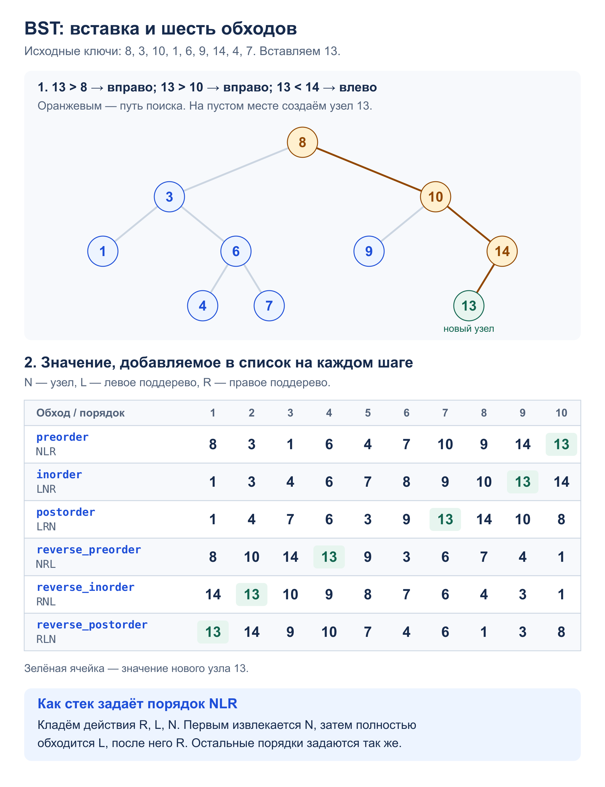

# Задача 1. Tree Traversal

Реализовать BST, вставку и шесть обходов. Каждый обход возвращает список значений.

[Решение](solution.py) · [Тесты](test_solution.py) · [Узел дерева](../tree.py)

## Алгоритм

`BinarySearchTree.insert(value)` идёт от корня: меньшее значение – влево,
большее – вправо. На месте отсутствующего ребёнка создаётся узел.
Так новый ключ попадает в диапазон, заданный всеми предками, и порядок BST сохраняется.
Повторная вставка существующего значения ничего не меняет.

В обходах `N` означает текущий узел, `L` и `R` – его левое и правое поддеревья:

| Функция | Порядок |
| --- | --- |
| `preorder` | NLR |
| `inorder` | LNR |
| `postorder` | LRN |
| `reverse_preorder` | NRL |
| `reverse_inorder` | RNL |
| `reverse_postorder` | RLN |

Порядки взяты из [статьи об обходах](https://en.wikipedia.org/wiki/Tree_traversal#Depth-first_search).
В reverse-обходах правое поддерево посещается раньше левого.

Общий `_traverse` хранит в стеке узел и флаг `ready`.
При первом извлечении планируем три действия в обратном порядке, поскольку стек LIFO.
При `ready = True` записываем значение. Поэтому каждый узел попадает в ответ ровно
один раз, в выбранной позиции относительно его поддеревьев.
Обходы работают и на деревьях, не являющихся BST; дерево не меняется.

## Сложность

`n` – число узлов, `h` – высота дерева.

- Вставка: `O(h)` времени и `O(1)` дополнительной памяти. В сбалансированном дереве
  это `O(log n)` времени, в цепочке – `O(n)`. Самобалансировки нет.
- Построение из `n` вставок: до `O(n²)` времени, например для возрастающих ключей;
  сами узлы занимают `O(n)` памяти.
- Каждый обход: `O(n)` времени, `O(h)` для стека и `O(n)` для возвращаемого списка.
  На каждом уровне отложено не более трёх действий. Рекурсии нет.

## Пример: вставка 13 и шесть порядков посещения



## Запуск и тесты

Из корня репозитория. Программа строит дерево со схемы и печатает шесть списков:

```bash
python3 -m homework_4.Binary_Tree.tree_traversal.solution
python3 -m unittest homework_4.Binary_Tree.tree_traversal.test_solution -v
```

Тесты проверяют пустое дерево, один узел, повторы, отрицательные и большие числа,
пропущенных детей, обе цепочки из 10 000 узлов и сохранность дерева.
Для всех 874 порядков вставки от 0 до 6 ключей структура и обходы сравниваются
с отдельными рекурсивными решениями. Проверяется и вывод программы.
