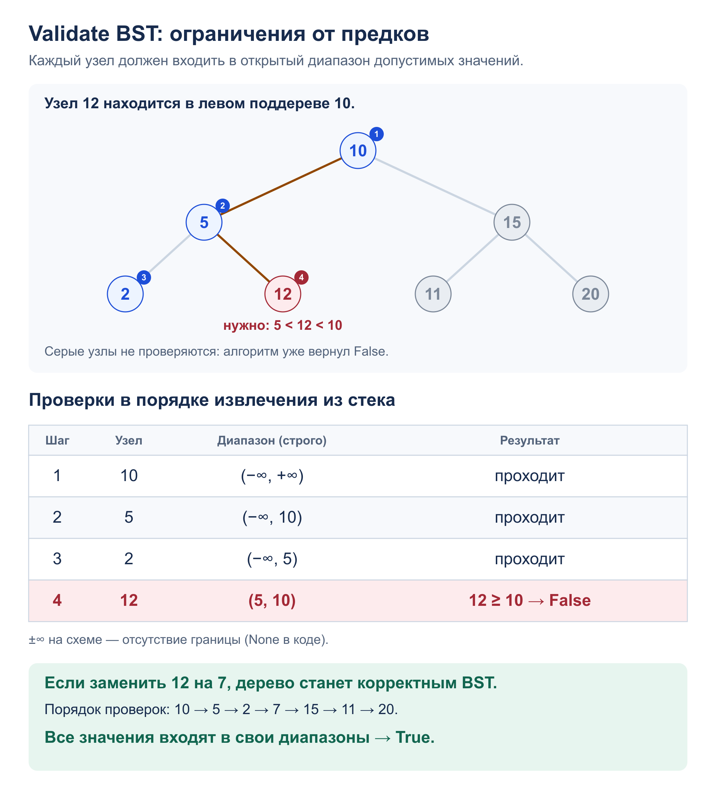

# Задача 2. Validate BST

Проверить произвольное бинарное дерево на строгий порядок BST. Ответ – `True` или `False`.

[Решение](solution.py) · [Тесты](test_solution.py) · [Узел дерева](../tree.py)

## Алгоритм

`is_valid_bst(root)` хранит в стеке узел и открытый диапазон допустимых значений.
У корня обе границы отсутствуют (`None`). Для левого ребёнка текущий ключ становится
верхней границей, для правого – нижней; другая граница сохраняется от предков.

Если значение не входит в диапазон, возвращаем `False`.
Так проверяются ограничения от всех предков: сравнения только с родителем недостаточно.
Если стек опустел без нарушения, каждый узел удовлетворяет порядку BST.
Дубликаты запрещены. Пустое дерево корректно. Дерево не меняется.

## Сложность

- Время: `O(n)` – каждый узел проверяется не более одного раза.
- Дополнительная память: `O(h)` для стека отложенных ветвей, где `h` – высота.
  В худшем случае `h = n`. Рекурсии нет.

## Пример: нарушение ограничения от предка



## Запуск и тесты

Из корня репозитория. Программа печатает `False` для дерева со схемы,
затем `True` после замены 12 на 7:

```bash
python3 -m homework_4.Binary_Tree.validate_bst.solution
python3 -m unittest homework_4.Binary_Tree.validate_bst.test_solution -v
```

Тесты проверяют пустое дерево, один узел, обе границы, нарушения у детей и потомков,
дубликаты, большие числа, цепочки из 10 000 узлов и сохранность дерева.
Все 1291 дерево до четырёх узлов со значениями −1, 0, 1 проверяются
через независимый критерий: inorder должен строго возрастать.
Также проверяется вывод программы.
