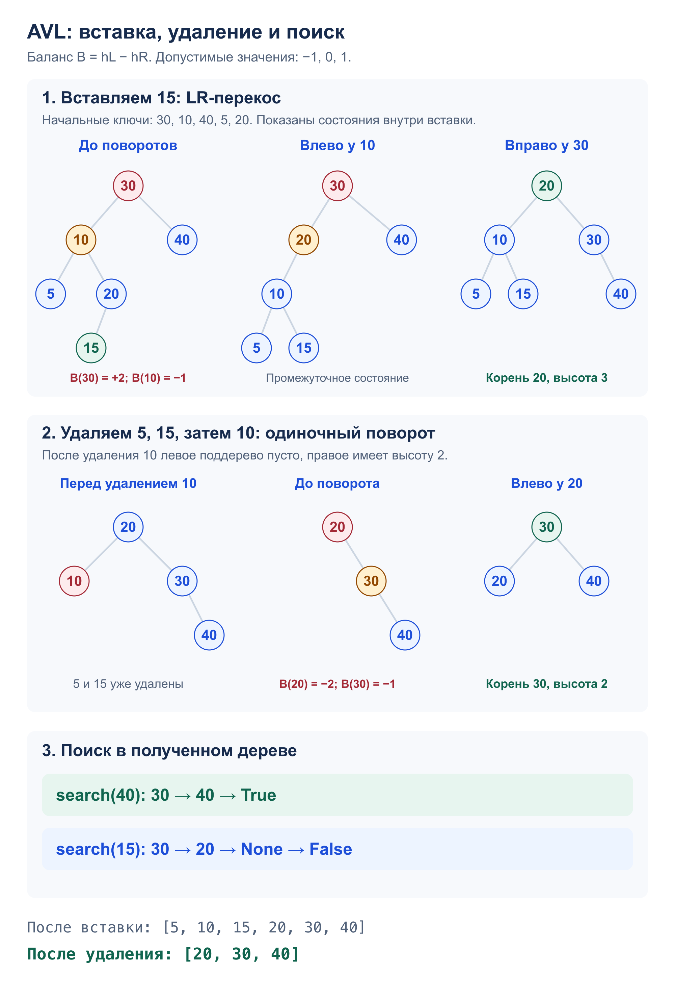

# Задача 3. AVL

Реализовать AVL-дерево с вставкой, удалением и поиском.

[Решение](solution.py) · [Тесты](test_solution.py)

## Алгоритм

`AVL` хранит корень дерева, каждый `Node` – значение, детей и высоту.
Высота пустого поддерева равна 0, листа – 1. Баланс узла – высота слева минус высота справа;
его модуль должен быть не больше 1.

- `insert(value)` вставляет ключ как в BST. Повторная вставка ничего не меняет.
- `delete(value)` удаляет лист или заменяет узел его единственным ребёнком.
  При двух детях берёт минимальный ключ справа и удаляет его прежний узел.
  Удаление отсутствующего ключа ничего не меняет.
- `search(value)` идёт влево или вправо по сравнению ключей и возвращает `True` или `False`.

После вставки и удаления на обратном пути пересчитываем высоты и восстанавливаем баланс:

| Перекос | Поворот |
| --- | --- |
| LL | вправо у узла |
| RR | влево у узла |
| LR | влево у левого ребёнка, затем вправо у узла |
| RL | вправо у правого ребёнка, затем влево у узла |

Повороты сохраняют порядок ключей: среднее поддерево переходит между двумя узлами,
оставаясь между ними по значениям. Высоты обновляются сначала у прежнего корня,
затем у нового. Перебалансировка каждого предка восстанавливает свойства AVL
на всём пути до корня, в том числе после удаления.

`inorder()` возвращает отсортированный список ключей для проверки и вывода.

## Сложность

`n` – число узлов в дереве.

- Вставка, удаление и поиск: `O(log n)` времени – высота AVL равна `O(log n)`,
  а пересчёт высоты и один поворот занимают `O(1)`.
- Вставка и удаление: `O(log n)` дополнительной памяти для рекурсии;
  поиск: `O(1)`. Узлы дерева занимают `O(n)` памяти.
- `inorder()`: `O(n)` времени, `O(log n)` для стека и `O(n)` для результата.

## Пример: вставка, удаление и поиск



## Запуск и тесты

Из корня репозитория. Программа выполняет пример со схемы:

```bash
python3 -m homework_5.AVL.solution
python3 -m unittest homework_5.AVL.test_solution -v
```

Тесты проверяют все четыре поворота при вставке и удалении, удаление узлов
с нулём, одним и двумя детьми, повторы, поиск и большие числа.
После операций проверяются порядок BST, высоты, баланс и отсутствие циклов.
Есть перебор малых порядков вставки и удаления, 4000 смешанных операций
в сравнении с `set`. Дерево из 10 000 ключей строится по возрастанию и убыванию,
затем полностью опустошается.
