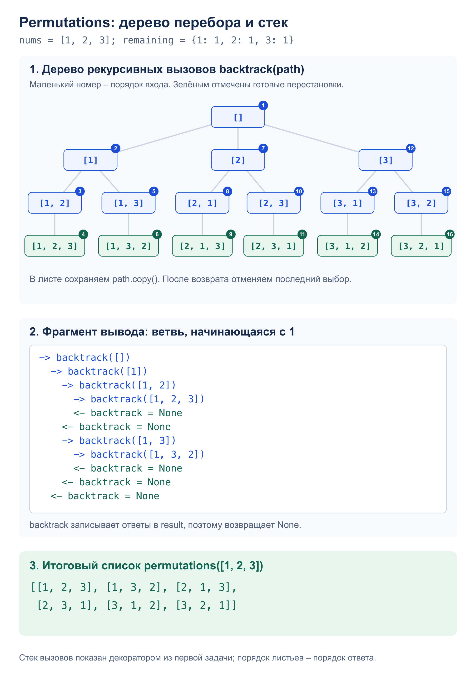

# Задача 2. Permutations

Вернуть все перестановки массива. Повторяющиеся значения не создают одинаковых ответов.

[Решение](solution.py) · [Тесты](test_solution.py) · [Декоратор](../tracer/solution.py)

## Алгоритм

`permutations(nums, trace=True)` строит ответ перебором с возвратом.
Словарь `remaining` хранит количество доступных копий каждого числа.
`backtrack(path)` выбирает число с ненулевым счётчиком, уменьшает счётчик
и добавляет число в путь. После рекурсивного вызова удаляет его и восстанавливает счётчик.
Когда длина пути равна длине входа, сохраняется копия `path`.

На каждом шаге пробуем каждое доступное значение один раз.
Любая перестановка задаёт единственную последовательность таких выборов,
поэтому все варианты получаются без повторов. Порядок выбора значений совпадает
с порядком их первого появления во входе. Входной массив не меняется;
для пустого массива ответ – `[[]]`.

Рекурсивная функция обёрнута в `tracer` из первой задачи. Она записывает ответы
в `result` и возвращает `None`, что видно в трассе; итоговый список возвращает
`permutations`. Параметр `trace=False` отключает вывод.

## Сложность

Для `n` различных чисел:

- Время: `O(n · n!)` – перебор вариантов и копирование `n!` списков длины `n`.
- Память ответа: `O(n · n!)`. Дополнительная память: `O(n)` для пути,
  счётчиков и рекурсивного стека.
- При включённой трассировке добавляется `O(S)` времени на форматирование и вывод
  `S` символов. Повторы во входе уменьшают число вариантов.

## Пример: `[1, 2, 3]`



## Запуск и тесты

Из корня репозитория. Введите числа через пробел, например `1 2 3`.
Пустая строка задаёт пустой массив. Программа печатает трассу, затем список перестановок:

```bash
python3 -m homework_5.permutations.solution
python3 -m unittest homework_5.permutations.test_solution -v
```

Тесты проверяют все примеры, пустой массив, повторы, отрицательные и большие числа,
сохранность входа, независимость списков результата и 5040 перестановок семи чисел.
Для 364 массивов длины до пяти ответ сравнивается с `itertools.permutations`.
Отдельно проверяются вложенность трассы, отключение вывода и ввод-вывод программы.
