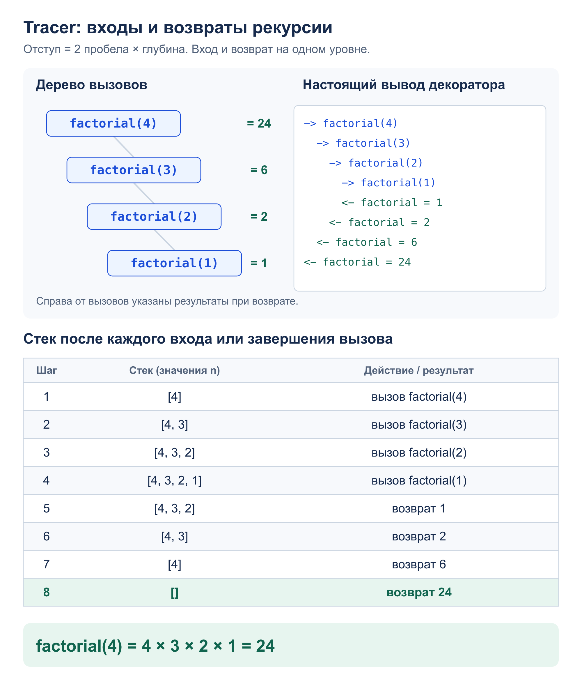

# Задача 1. Tracer

Реализовать декоратор, который показывает вызовы рекурсивной функции и возвраты с результатом.

[Решение](solution.py) · [Тесты](test_solution.py)

## Алгоритм

`@tracer` печатает `-> имя(аргументы)` перед вызовом и `<- имя = результат`
после его завершения. На каждый уровень стека добавляются два пробела.
Вход и возврат одного вызова имеют одинаковый отступ.

Глубина хранится в обычном счётчике `_depth`, общем для обёрнутых функций.
Перед вызовом увеличиваем его на 1, в `finally` уменьшаем, в том числе после ошибки.
При исключении строка `!!` показывает ошибку, затем она передаётся вызывающему коду.
`wraps` сохраняет имя и описание функции.
Аргументы передаются без изменений, возвращается тот же результат.

## Сложность

- Накладное время: `O(S)`, где `S` – число символов трассы, включая отступы
  и представления аргументов и результатов. Для каждого вызова печатаются две строки.
- Дополнительная память: `O(h)` для обёрток на глубине `h`, плюс память
  для одной форматируемой строки. Сам декоратор трассу не сохраняет.
  Память и вычисления исходной функции учитываются отдельно.

## Пример: `factorial(4)`



## Запуск и тесты

Из корня репозитория. Программа показывает трассу `factorial(4)` и результат 24:

```bash
python3 -m homework_5.tracer.solution
python3 -m unittest homework_5.tracer.test_solution -v
```

Тесты проверяют обычную, ветвящуюся и взаимную рекурсию, аргументы по имени,
возврат `None`, сохранение метаданных, повторные вызовы и восстановление глубины
после исключений. Также проверяются совместная трассировка перестановок
с другой обёрнутой функцией и вывод программы.
